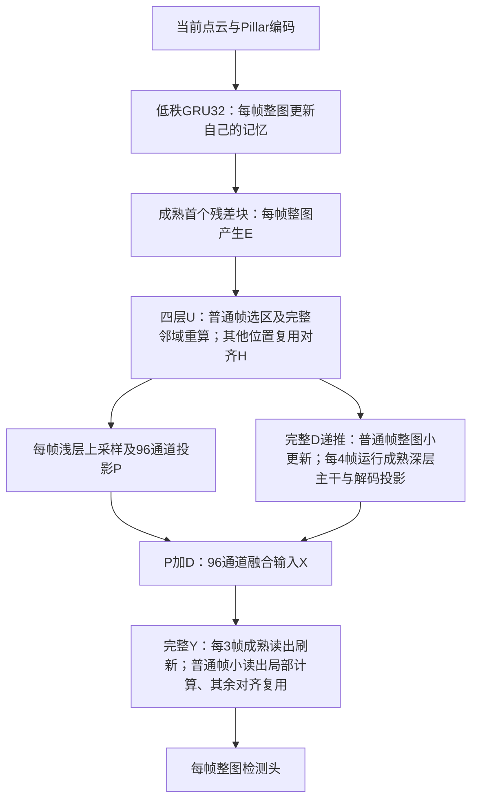

# H/D/Y分层缓存：保留基线与证据边界

用户于2026-10-27明确要求保留此架构，并并行探索只缓存Y的简化版。本文是可独立阅读的保留说明；新实验不能覆盖、重命名或删除以下权重、报告和实现。

## 架构及更新位置

- H是完整128通道第一级输出；U是两个残差块中的四个3×3空间更新，采用rank96投影，普通帧执行所有必要依赖。H每3帧或距上次完整刷新0.25秒刷新，另有场景/FM重置。未选H不经更新器；参考只随实际写回更新。
- D是第二、三级主干上采样后经线性投影得到的96通道深层贡献。普通帧用H、对齐完整旧D、覆盖标记，经width32的1×1/DW3×3/1×1修正并写回完整D。主方案是小更新器整图执行，完整深层每4帧或0.35秒刷新。此前D局部化另有实验，不混入主方案。
- Y是检测头前256通道完整特征。成熟读出加工X=P+D；新current小读出为96→64的3×3、64→64的3×3、64→256的1×1，第二3×3后至1×1之间不加激活。更新位置由当前X与保留参考比较并加覆盖/置信保护。第一3×3只计算核心及一格邻域，后续只算核心；输入依赖半径2。未选Y直接沿用位姿对齐值。
- 当前无门控current网络的选中输出不直接读取旧Y，但X的上游仍有FM及D历史。H/D/Y各有自己的状态坐标和刷新规则，不由GRU的一次对齐替代。Y默认3帧/0.25秒，5帧/0.45秒是额外候选。
- 各阶段对齐为自车位姿SE(2)最近邻BEV变换，不包含目标运动预测。刷新周期独立；场景/FM重置强制刷新。

## 两个明确保留的工作点

### A：成熟读出局部复用，偏精度

来源：[完整配对](int_spike_results/cache_repair_20261017/recurrent_readout_layout_v1_20261026_report.json)。H固定四层局部方案＋D4递推＋成熟读出局部计算，连续缓存、row32768。

| 同轮模式 | AP70 | Conv/Linear GFLOPs | mean ms | P95 ms |
|---|---:|---:|---:|---:|
| 固定四层H基线、原D3机制 |75.53159775%|119.43160|18.98464|28.40866|
| D4、整图成熟读出 |75.55115950%|108.55951|17.70266|30.12566|
| D4、局部成熟读出、连续缓存 |75.53869833%|99.28897|18.61583|32.22393|

相对同轮固定H基线少16.87%计算量，平均模型时间少1.94%，AP基本保持；P95增加。相对D4整图读出仍更慢。不得将其改称“所有延迟指标提升”。

### B：小读出加局部复用，偏计算量

来源：[七模式配对](int_spike_results/cache_repair_20261017/current_readout_layouts_e9_full_v1_20261027_report.json)。固定current epoch9，邻域索引复用后端。

| 同轮模式 | AP70 | Conv/Linear GFLOPs | mean ms | P95 ms |
|---|---:|---:|---:|---:|
| 固定四层H基线 |75.53159775%|119.43160|19.47156|28.67542|
| D4、整图成熟读出 |75.55115950%|108.55951|18.23537|30.90659|
| D4、整图小读出 |75.46006743%|96.76345|18.05755|30.88247|
| D4、局部小读出、复用邻域索引 |75.43868133%|94.59200|18.89340|32.08180|

局部化小读出的独立增量是再省2.17145G、AP下降0.02139个百分点，但平均时间增加0.83585ms。总状态86.0832MB，另计邻域表1.8144MB及预排权重0.36864MB。整图小读出状态76.4064MB，固定H基线50.5008MB。布局不等于缓存容量压缩。

所有AP为5794扫描/1738标签。时间是同轮、去前10预热后的模型均值/P95，不含I/O、H2D、后处理或冷启动；不能跨表比较绝对时间。MAC×2沿用既有卷积/线性执行口径，不是整机能耗。参照75.5316%是本路线固定四层基线，不是原INT75.8736%。

## 身份与复现入口

- 代码：`opencood/models/sub_modules/int_recurrent_deep.py`（D），`int_planned_row_state.py`（H局部执行），`int_local_current_readout.py`（小Y局部执行），`int_packed_readout.py`等成熟读出布局实现。
- 原INT源权重：`full_gru`最佳e17，SHA256 c7bbee9b4fdefc031a61b240d6c504665d66c0c788610bb36c97d34118f8a6b8。
- FM32最佳e11：1a267575ef735f203526fa3b8196334d32d9ff8a9080449c3b6206247913e5ef。
- H rank96恢复e0：2424236f88bafb04325ec07803ba5f99614c5ab3762e951eed365725f0b3af62。
- D为六帧训练e5、四帧部署：d1f7d3f07c50891eb6f3808b488cde418254523d13acf23f9423138106bbe2ec。
- B的小读出：`/data2/tzm/workspace/diagnostics/int_cache_repair_20261017/current_readout_r64_current_v1_20261026/epoch_009/repair.pth`，SHA256 5edd14cbe48d7dbdb9129ccbb9dc40544701a480d0adfda6ba3dcd251119faf8。
- 选择阈值0.5651477366679742，原512训练扫描标定后冻结并转移；不在验证集搜索。完整命令、其余源文件身份见对应归档`launch.json`、`contract.json`及`local_current_contract.json`。
- 本地代码只在main修改并push，181仓库`/data2/tzm/workspace/OpenCOOD` pull；异机恢复包在146 `/data1/zhh/gzc/int181_snapshot/live_backups/`。

## 可以支持与不能支持的结论

已验证：H/D/Y各段可以产生计算收益；同权重刷新周期、Y整图/局部及D整图/局部已有配对。D局部化仅省0.16021G，mean17.843→18.254ms，故主方案保留其整图小更新。旧残差Y修正36轮仍65.21%/66.50%，current最佳75.47093%、门控75.33609%，均保留失败记录。

尚未证明：三个缓存都必要、三处划分最优、性能增益来自单一结构因素、各层固有变化速度严格有序、当前局部后端具有普遍GPU加速、SNN独立价值。H/D/Y是成熟计算图的接口，不是已证实互相独立的语义因子。后续删减实验可以简化结构，不能倒推此前方案无效。

Y-only是独立实验路线，目标是普通帧完全绕过H/D及成熟读出。它必须重新验证精度和总成本；不能把本表结果移植过去，也不能把训练中丢弃的教师计算计作部署计算。

### 2026-10-27 18:46 匹配微调闭环

两条从冻结e9启动、只改训练刷新周期的匹配微调均按既定平台规则结束：

| Y刷新周期 | 完成训练轮数 | 最佳AP70 | 最佳轮次 | 末轮AP70 | 末轮lr |
|---|---:|---:|---:|---:|---:|
| 三帧 | 8 | 75.46006743% | 初始化0 | 75.158864% | 2.5e-5 |
| 五帧 | 9 | 75.25527698% | 初始化0 | 75.028851% | 2.5e-5 |

结论：此损失、初始化与优化协议下，匹配微调未带来精度提升；不据此认定任何匹配训练都无效，也不称已找到全局最优。保留此前H/D/Y冻结基线与局部复用结果，不用末轮权重替换，不重复启动同配置。完整5794/1738报告、history、best及终态已归档。三帧终态latest（含优化器/调度器）、最佳权重及契约已备份146：int_hdy_p3_final_20261027_1848.tar.gz，1,631,107字节，SHA256 d31f0c458fd49b826e42a4a8f6116d547dfc0521bc3eb4e873a7f65e2610b76f，来源/中转/目的地一致；五帧终态见上一轮备份记录。