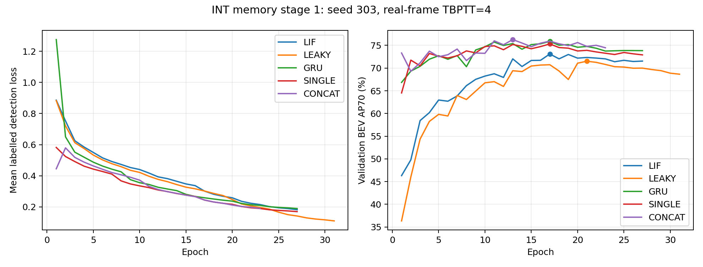

# INT 脉冲特征记忆：五模型阶段验收（2026-10-15）

INT FM-only 的局部 SNN 改造及五模型比较已完成训练、最佳权重独立重放和历史干预。LIF 优于本轮连续泄漏对照，但低于 GRU、Concat 和单帧，当前证据不足以证明脉冲记忆相对成熟 ANN 的独立优势。

## 结果

以下均为 seed 303、验证集选模后的 **BEV AP70（%），不是 3D AP**。每次评估包含 5794 次扫描、1738 个标注帧、22971 个 GT 框。

| 模型 | 完成轮数 / 最佳轮次 | 正常输入／位姿对齐历史 | 每帧清空历史 | 保留历史但不对齐 | 对齐历史相对清空的增益（百分点） |
| --- | ---: | ---: | ---: | ---: | ---: |
| LIF | 27 / 17 | 73.10 | 72.57 | 62.34 | +0.53 |
| Leaky | 31 / 21 | 71.51 | 71.43 | 53.22 | +0.08 |
| GRU | 27 / 17 | 75.87 | 74.35 | 71.46 | +1.52 |
| Concat | 23 / 13 | **76.27** | 74.70 | 73.46 | +1.57 |
| 单帧 | 27 / 17 | 75.31 | 不适用 | 不适用 | 不适用 |

LIF 对齐结果比 Leaky 高 **1.59** 个百分点，比 GRU 低 **2.77** 个百分点。清空历史后，LIF 比 Leaky 仍高 **1.14** 个百分点，因此不能把全部 1.59 个百分点归因为跨帧脉冲记忆。LIF、Leaky、GRU 取消对齐分别下降 10.76、18.29、4.41 个百分点：位姿对齐对这套缓存实现很重要。

Concat 比单帧高 0.96 个百分点；LIF 比单帧低 2.21、比 Concat 低 3.18 个百分点。Concat 清空历史下降 1.57 个百分点，取消对齐下降 2.82 个百分点。跨模型差值和同模型推理干预回答不同问题，不能将 Concat 相对单帧的 0.96 与其清空历史的 1.57 混为一谈。

五组都满足预先固定的验证平台停止条件：至少 20 轮、连续 10 轮没有超过 0.001 AP70 的有效改善、学习率不高于初始值的 1/8。Leaky 和 GRU 从中断检查点恢复后分别完成至第 31、27 轮，最佳轮次未改变。这里的“收敛”仅指达到该停止规则，不代表数学意义上的收敛或全局最优。

## 可比性和实现边界

- 配置：`opencood/hypes_yaml/dair-v2x/snn/int_ego_memory.yaml`。使用服务器既有 DAIR 车端数据，自车连续帧，无路端融合、随机延迟或异步训练。
- 五组使用相同冻结清单、P1 空间初始化、seed 303、四帧窗口更新、优化器及停止规则。四种记忆模型首轮 FM-only 后联合训练；单帧无 FM，从首轮训练空间网络，四帧窗口仅用于梯度累积。这是明确披露的结构性预热差异。记忆模型的 TBPTT=4 是梯度窗口，状态沿完整片段延续，不是仅记忆四帧；跨场景重置。
- LIF 每次真实扫描只更新一次；输入投影、连续膜电位、连续突触迹、线性读出以及后续检测器仍包含 ANN 计算。这是局部 SNN，不是全脉冲检测网络。
- LIF 与 Leaky 参数结构及状态宽度相同，缓存均为 U32+R32，FP32 共 25,804,800 字节。GRU 为 64 个隐藏通道加 age，共 26,208,000 字节；缓存容量接近，但通道构成、参数量与运算量并不相同。
- Concat 缓存为 64 通道、25,804,800 字节，单帧为 0 字节。Concat 与 LIF 的缓存字节相同，不代表中间表示容量、参数量及计算量匹配。
- Leaky 同时移除了二值发放和减阈值复位，不能分离两者的作用。reset/no-align 是固定权重的推理干预，未重新训练对应模型。
- 目前仅一个种子、验证选模，没有独立测试集结论或多种子置信区间。不将上述差值表述为统计显著改善。
- 不同 GPU 上的诊断计时包含统计同步，且不是受控性能基准；稠密 GPU 实现不会因发放稀疏自动跳过计算，因此不宣称加速或节能。
- 早期 ANN 基线使用不同的跨帧梯度训练协议，本轮应优先与表中的 GRU 比较。

## 验收证据

审计脚本 `opencood/tools/summarize_int_memory.py` 在服务器提交 `adfd266` 上以 `--modes lif leaky gru single concat` 实际返回 `AUDITED`：

1. 五组检查点、配置、数据清单哈希一致，latest.pth 实际满足停止规则；全部 135 个完成轮次的覆盖及有限数值检查通过。
2. 十三次评估逐帧核对顺序、时间戳、片段和监督标志；每次覆盖 5794 帧。四种记忆模型的 aligned 为 214 次场景初始化/重置、5580 次 warp；reset 为 5794 次重置且无 warp；no-align 为 214 次重置且无 warp。单帧全部 5794 帧缓存为 0、无 warp。
3. 最佳权重独立重放与训练时评估的最大 AP 绝对误差：LIF 3.88e-7、Leaky 3.43e-9、GRU 1.43e-8、单帧 7.43e-9、Concat 1.01e-8，均小于预设 1e-6 容差。
4. Leaky/GRU 恢复训练的最初 64 次扫描与保留的中断前缀顺序相同，所有可比标注帧 loss 精确一致。

五模型机器可读审计结果：[report.json](int_spike_results/five_models_20261015/report.json)。原三模型审计另保留在 [原 report.json](int_spike_results/report.json)。完整训练曲线及重放启动记录：[三模型](int_spike_results/training_complete_20261013.json)、[补充两模型](int_spike_results/baseline_training_complete_20261015.json)。恢复记录：[resume_20261013.json](int_spike_results/resume_20261013.json)。协议：[int_spike_memory_protocol.md](int_spike_memory_protocol.md)。

服务器证据根目录：`/data0/chen/gzc/workspace/diagnostics/int_spike_20260930`。原始训练为 `full_{lif,leaky,gru,single,concat}`，重放为 `replay_{mode}/{aligned,reset,no-align}`（单帧仅 aligned）；五模型审计输出为 `stage1_five_models_20261015`，原三模型输出 `stage1_report_20261013` 保留。最佳 checkpoint 的完整路径和 SHA256 见对应 report.json，不用 latest.pth 替代最佳权重。

## 下一步研究判断

本轮工程目标完成，脉冲状态的独立价值尚未成立。下一轮优先检验 32 通道中间表示是否限制了 LIF/Leaky：成对比较 32 与 64 通道，并同时报告参数量和状态字节；64 通道 U+R 会增加缓存预算，不能称为等预算提升。然后再分离二值发放与复位机制，并对候选方案做多种子复核。上述是后续实验建议，本次验收不额外启动新训练。

## 按用户要求补齐 Concat 与单帧（2026-10-13）

旧协议单帧 BEV AP70 为 74.30%，Concat 为 75.50%，但它们采用逐帧截断梯度/逐帧更新，没有本轮首轮 FM 预热，不能直接填入主表作为同协议对照。主表已增补两行，待本轮全量实验和最佳权重独立重放后填入结果；旧数值仅作历史参考。

补充实验保持相同完整清单、原始 P1 初始化、seed 303、AdamW、窗口内标注损失均值、每 4 帧窗口一次更新、冻结 BN、无增强、验证选模和停止规则。Concat 首轮 FM-only、随后联合训练；单帧没有 FM，首轮直接更新空间网络，明确记录 `fm_only_epochs=0`。单帧中的四帧窗口仅用于梯度累积，输入和推理始终只有当前帧。此结构性预热差异予以披露，不将两者称为完全相同训练日程。

两组已通过两轮工程验证，证据见 [baseline_pilot_audit_20261013.json](int_spike_results/baseline_pilot_audit_20261013.json)。全量结果目录为服务器原实验根目录下的 `full_single`、`full_concat`，启动记录 `launch_full_single_concat.json`。至少训练 20 轮，连续 10 轮无 >0.001 AP70 改善且 LR 不高于初始值 1/8 才停止，最多 40 轮；达到上限仍无平台时必须单独评估，不能宣称收敛。工程验证权重不用于正式初始化。

后续跟进查进程和 `curve.json`，不要重复启动；若中断，使用 `resume_int_memory.py --root <原根目录> --launch-record launch_full_single_concat.json` 检查后恢复。训练结束后对 Concat 重放 aligned/reset/no-align，对单帧只重放 aligned（无历史干预意义）；最后以 `summarize_int_memory.py --modes lif leaky gru single concat` 审计五组，输出到新的报告目录，保留第一轮证据。

全量训练已从提交 `af38083` 启动：单帧 GPU0/PID2194388，Concat GPU2/PID2194389；完整命令和哈希见 [launch_full_single_concat.json](int_spike_results/launch_full_single_concat.json)。这些 PID 是启动时记录，后续需核对实际进程命令。定时跟进已恢复，间隔 60 分钟，提示词“推进基线，仅完成或异常通知”。

### 2026-10-15 训练验收完成，重放进行中

单帧完成 27 轮、最佳第 17 轮（AP70 0.7531268558）；Concat 完成 23 轮、最佳第 13 轮（0.7627485189）。两组均为 PLATEAU_REACHED，实际 latest.pth 的 epoch/stale/LR 满足停止规则，全部 50 个完成轮次的训练/验证覆盖和有限数值检查通过，输入与最佳权重哈希一致，无 failure.json。表内新两行仍是训练选模值，待独立重放验收。

已在空闲 GPU0/2 启动 `replay_single`（worker PID2402455）和 `replay_concat`（PID2402462）。单帧仅 aligned；Concat 顺序 aligned/reset/no-align。进度以各目录 status.json 和实际进程命令为准，不重复启动。完整训练曲线、停止状态与重放启动证据见 [baseline_training_complete_20261015.json](int_spike_results/baseline_training_complete_20261015.json)。两组重放完成后运行五模型汇总审计，输出到新的 `stage1_five_models_20261015` 目录，归档新 JSON/曲线并更新主表，旧三模型报告保留。

### 2026-10-15 最终验收完成

上述重放均已 COMPLETED，五模型汇总审计已返回 AUDITED。主表已替换为独立重放值，Concat 的 reset/no-align 为 74.70%/73.46%，相对 aligned 分别下降 1.57/2.82 个百分点。全部五组训练和十三次评估已完成，本轮补齐基线的任务结束；无需再次训练或重放。定时检查在最终归档后暂停。
