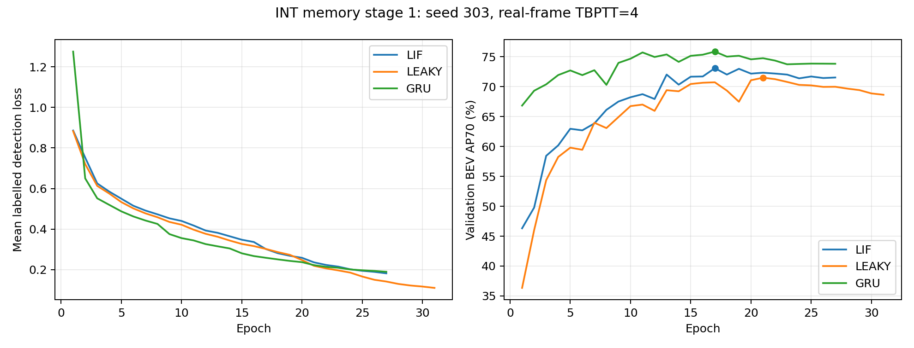

# INT 脉冲特征记忆：第一轮阶段验收（2026-10-13）

INT FM-only 的局部 SNN 改造已完成训练、最佳权重独立重放和历史干预。LIF 优于本轮连续泄漏对照，但未超过同训练协议的 GRU，当前证据不足以证明脉冲记忆相对成熟 ANN 的独立优势。

## 结果

以下均为 seed 303、验证集选模后的 **BEV AP70（%），不是 3D AP**。每次评估包含 5794 次扫描、1738 个标注帧、22971 个 GT 框。

| 模型 | 完成轮数 / 最佳轮次 | 位姿对齐历史 | 每帧清空历史 | 保留历史但不对齐 | 对齐历史相对清空的增益（百分点） |
| --- | ---: | ---: | ---: | ---: | ---: |
| LIF | 27 / 17 | 73.10 | 72.57 | 62.34 | +0.53 |
| Leaky | 31 / 21 | 71.51 | 71.43 | 53.22 | +0.08 |
| GRU | 27 / 17 | 75.87 | 74.35 | 71.46 | +1.52 |
| Concat（本轮协议补跑） | 待完成 | 待测 | 待测 | 待测 | 待测 |
| 单帧（本轮优化协议补跑） | 待完成 | 待测 | 不适用 | 不适用 | 不适用 |

LIF 对齐结果比 Leaky 高 **1.59** 个百分点，比 GRU 低 **2.77** 个百分点。清空历史后，LIF 比 Leaky 仍高 **1.14** 个百分点，因此不能把全部 1.59 个百分点归因为跨帧脉冲记忆。LIF、Leaky、GRU 取消对齐分别下降 10.76、18.29、4.41 个百分点：位姿对齐对这套缓存实现很重要。

三组都满足预先固定的验证平台停止条件：至少 20 轮、连续 10 轮没有超过 0.001 AP70 的有效改善、学习率不高于初始值的 1/8。Leaky 和 GRU 从中断检查点恢复后分别完成至第 31、27 轮，最佳轮次未改变。这里的“收敛”仅指达到该停止规则，不代表数学意义上的收敛或全局最优。

## 可比性和实现边界

- 配置：`opencood/hypes_yaml/dair-v2x/snn/int_ego_memory.yaml`。使用服务器既有 DAIR 车端数据，自车连续帧，无路端融合、随机延迟或异步训练。
- 三组使用相同冻结清单、P1 空间初始化、seed 303、首轮 FM-only 后联合训练、真实帧 TBPTT=4、优化器及停止规则。TBPTT=4 是梯度窗口，状态沿完整片段延续，不是仅记忆四帧；跨场景重置。
- LIF 每次真实扫描只更新一次；输入投影、连续膜电位、连续突触迹、线性读出以及后续检测器仍包含 ANN 计算。这是局部 SNN，不是全脉冲检测网络。
- LIF 与 Leaky 参数结构及状态宽度相同，缓存均为 U32+R32，FP32 共 25,804,800 字节。GRU 为 64 个隐藏通道加 age，共 26,208,000 字节；缓存容量接近，但通道构成、参数量与运算量并不相同。
- Leaky 同时移除了二值发放和减阈值复位，不能分离两者的作用。reset/no-align 是固定权重的推理干预，未重新训练对应模型。
- 目前仅一个种子、验证选模，没有独立测试集结论或多种子置信区间。不将上述差值表述为统计显著改善。
- 不同 GPU 上的诊断计时包含统计同步，且不是受控性能基准；稠密 GPU 实现不会因发放稀疏自动跳过计算，因此不宣称加速或节能。
- 早期 ANN 基线使用不同的跨帧梯度训练协议，本轮应优先与表中的 GRU 比较。

## 验收证据

审计脚本 `opencood/tools/summarize_int_memory.py`（提交 `926a677`）实际返回 `AUDITED`：

1. 三组检查点、配置、数据清单哈希一致，latest.pth 实际满足停止规则；全部 85 个完成轮次的覆盖及有限数值检查通过。
2. 九次评估逐帧核对顺序、时间戳、片段和监督标志；每次覆盖 5794 帧。aligned 为 214 次场景初始化/重置、5580 次 warp；reset 为 5794 次重置且无 warp；no-align 为 214 次重置且无 warp。
3. 最佳权重独立重放与训练时评估的最大 AP 绝对误差：LIF 3.88e-7、Leaky 3.43e-9、GRU 1.43e-8，均小于预设 1e-6 容差。
4. Leaky/GRU 恢复训练的最初 64 次扫描与保留的中断前缀顺序相同，所有可比标注帧 loss 精确一致。

机器可读审计结果：[report.json](int_spike_results/report.json)。完整训练曲线及重放启动记录：[training_complete_20261013.json](int_spike_results/training_complete_20261013.json)。恢复记录：[resume_20261013.json](int_spike_results/resume_20261013.json)。协议：[int_spike_memory_protocol.md](int_spike_memory_protocol.md)。

服务器证据根目录：`/data0/chen/gzc/workspace/diagnostics/int_spike_20260930`。原始训练为 `full_{lif,leaky,gru}`，九次重放为 `replay_{mode}/{aligned,reset,no-align}`；本轮审计输出为 `stage1_report_20261013`。最佳 checkpoint 的完整路径和 SHA256 见 report.json，不用 latest.pth 替代最佳权重。

## 下一步研究判断

本轮工程目标完成，脉冲状态的独立价值尚未成立。下一轮优先检验 32 通道中间表示是否限制了 LIF/Leaky：成对比较 32 与 64 通道，并同时报告参数量和状态字节；64 通道 U+R 会增加缓存预算，不能称为等预算提升。然后再分离二值发放与复位机制，并对候选方案做多种子复核。上述是后续实验建议，本次验收不额外启动新训练。
