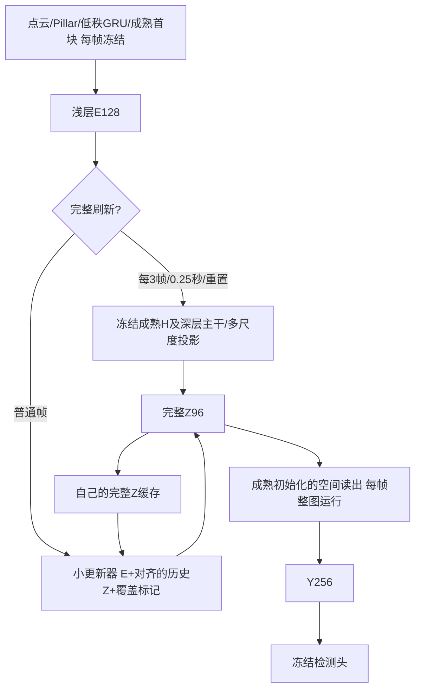

# 当前阶段：缓存读出之前的Z，优先固定成熟读出改善修正

2026-10-28用户确认：不直接预测检测头前Y，改为预测更早的特征，让后续可训练网络吸收历史对齐与更新误差。保留[H/D/Y已验证基线](int_hdy_reference_20261027.md)和[Y-only实验](int_y_only_plan_20261027.md)，本版仍以近似原INT精度、历史整体对齐与变化区域更新为目标，不以简化层数本身判定成功。

<!-- Z_CACHE_CURRENT_BEGIN -->
## 当前状态（2026-10-28 19:02）

| 实验 | 最佳完整验证BEV AP70 | 训练状态 |
|---|---:|---|
| 完整当前Z＋固定成熟读出 | 75.67910703% | 固定参照 |
| 原Z更新器，冻结读出 | 74.37135085%（e26） | 平台停止 |
| 原Z更新器，联合训练读出 | 74.38857379%（e33） | 平台停止 |
| e26权重重新初始化优化器，plain对照 | 74.49184783%（新e6） | 新e8平台停止 |
| 同源初始化，dilated上下文 | 74.04902741%（新e15） | 正在e16训练，最多20轮 |
| joint e33更新器，换回固定读出 | 74.94204640%（新e3） | 已完成e4，正在e5训练，接近平台判据 |

joint已在e33自然触发原平台判据（stale4，更新器/读出lr2.5e-5/2.5e-6），plain对照在新e8平台停止（stale4，lr3.125e-6）。不再机械追加训练。原joint与frozen结果相近，轮数不同，不能宣称联合读出有稳定优势；plain更高，但仍比完整参照低1.18726个百分点，尚不能替代HDY已验证基线。平台指预先设定的停止规则，不是数学意义上的精度上限。

joint e33的“完整当前Z＋适配读出”为74.79098707%，比固定读出参照低0.88812个百分点。同Z读出审计已完成全部5794扫描/1738标注，逐帧Z完全相同。固定读出74.54604574%，适配读出74.38857379%，适配下降0.15747个百分点；完整Z路径下降0.88812个百分点。控制均复现，审计延迟全部置空。当前e33检查支持保留固定成熟读出，不能泛化成联合训练必然无效。利用空闲GPU1启动z_joint_e33_fixed_recovery_v1_20261028（PID24574）：保留e33更新器，恢复并冻结成熟读出，新优化器2.5e-5、12轮预算，先核对e0复现审计。它是明确的新适配实验，不是原joint精确续训。实现002d158已push/pull，9项专项测试通过（0.657秒）。启动器259项INT测试通过（7.734秒），32真实帧工程检查通过，初始化来源SHA与e33审计一致；完整e0验证精确复现74.54604574%；新e1为74.92527602%、e2为74.89308676%、e3最佳74.94204640%、e4为74.85451638%。最佳较e0提高0.39600个百分点，但距完整参照仍差0.73706个百分点；e4 lr1.25e-5、stale3，正在e5训练，尚未达到最少6轮的平台停止条件。额外训练与固定读出共同构成这个恢复实验，不能把所有增益都归于读出交换。

上下文实验保持两组相同参数量、源e26权重和新AdamW lr2.5e-5，只把第二个3×3卷积dilation从1改为2；依赖半径2→3。plain e0精确复现74.37135085%，dilated e0降至42.36855049%，随后逐步恢复；e10为73.64946937%、e11为73.79135219%、e12为73.85406778%。12轮结束原因是budget_not_convergence，lr2.5e-5、stale0，最近两轮提高0.20460个百分点；仍落后plain最佳0.63778个百分点，尚无上下文优势证据。因仍在改善且未经历学习率下降，从e12 latest精确续至最多20轮，保留优化器/调度器和原平台规则，不重置训练。GPU3/PID30307，z_context_dilated_e26_resume1_v1_20261028；259项测试和32真实帧工程检查通过，resume.json确认next_epoch=13，最新e13为73.93184779%、e14为73.99091914%、e15为74.04902741%；lr2.5e-5、stale0，正在e16训练，尚落后plain最佳0.44282个百分点，继续当前有限预算。未来局部执行必须计入更大的邻域开销。

e24固定512训练扫描诊断已完成：年龄2换完整历史只减少约4.5%至4.6%的Z误差，年龄1误差仍明显；适配读出在同一Z上未稳定降低Y误差。该诊断支持优先检查单步重建，但不直接证明容量或上下文不足，也不能替代上述完整AP审计。

所有Z方案当前仍是小更新器整图执行，尚未局部跳算。平均114.97197812 GFLOPs（5794扫描、2005次完整Z刷新，读出每帧执行），FM+Z35,884,800字节；计算量仍高于HDY局部方案94.59200G。共享GPU不作跨组延迟比较。下一步检查固定读出再适配曲线与dilated续训的平台，依据准确率证据决定更新器改造，再推进变化区域重算；保留HDY作为已验证参照。

恢复组e4与dilated e15的latest、各自best及契约已备份至146（9,824,568字节），来源/本地中转/目的地SHA256一致：8644ce475ce451c6a42bf2db06bd7073286921bea05ab863731f6d82b5f376d3。此前平台终点备份保留。恢复组已接近最少6轮和stale4的平台判据，检查间隔临时缩短为30分钟，及时处理停止节点；dilated仍按既定20轮预算推进。

- [joint平台报告](int_spike_results/cache_repair_20261017/z_only_w64_joint_p3_resume3_v1_20261028_report.json)
- [frozen平台报告](int_spike_results/cache_repair_20261017/z_only_w64_frozen_p3_resume2_v1_20261028_report.json)
- [plain平台报告](int_spike_results/cache_repair_20261017/z_context_plain_e26_v1_20261028_report.json)
- [dilated完整续训曲线](int_spike_results/cache_repair_20261017/z_context_dilated_e26_resume1_v1_20261028_history.json)
- [同Z读出审计契约](int_spike_results/cache_repair_20261017/z_reader_joint_e33_audit_v1_20261028_reader_audit_contract.json)
- [审计工程检查](int_spike_results/cache_repair_20261017/z_reader_joint_e33_audit_v1_20261028_reader_audit_engineering.json)
- [e24诊断配对核验](int_spike_results/cache_repair_20261017/z_only_e24_diagnostic_comparison_20261028.json)
- [恢复组完整曲线](int_spike_results/cache_repair_20261017/z_joint_e33_fixed_recovery_v1_20261028_history.json)
- [19:00恢复点备份清单](int_spike_results/cache_repair_20261017/z_recovery_context_backup_20261028_1900.json)
<!-- Z_CACHE_CURRENT_END -->

## 首版网络

Z定义为现有SplitCompactReadout的current(H浅层解码)+history(深层解码)之和，位于第一层空间卷积之前，96通道，带正负值。每次完整刷新产生的H/D只作临时中间值，唯一空间缓存是Z，前端GRU的FM状态保留。普通帧不调用H四层U、深层两级、任何deblock及current/history投影；空间读出和检测头每帧完整执行。

小更新器固定width64：输入E128/历史Z96/覆盖1，1×1→两层3×3→有符号1×1候选，另一个1×1产生g=.95sigmoid×valid，输出g×旧Z+(1-g)×候选。隐藏层ReLU，最终候选不加ReLU；Z在激活之前，非负约束会改变特征含义。候选N(0,.001)/bias0，门weight0/bias4。沿用Y-only近似复制初始方案，不同时加宽网络、改周期或换选区，避免把多种新改动混成一个结论。

第一阶段小更新器整图运行，尚不执行局部跳算；其空间依赖半径2便于后续局部化。先恢复精度，再把未选Z直接沿用对齐缓存、选中Z和必要邻域重新计算；读出仍整图处理新旧接缝。读出每帧运行会增加普通帧成本，实际分支及序列MAC、状态字节、有效延迟必须重新测量，不能套用Y-only数字。

## 两条固定实验

| 方案 | Z更新器 | 读出空间卷积/BN affine | BN运行统计 | 检测头/前端/完整Z生成器 |
|---|---|---|---|---|
| frozen | 训练，lr1e-4 | 冻结 | 冻结 | 冻结 |
| joint，主方案 | 训练，lr1e-4 | 成熟初始化后训练，lr1e-5 | 冻结 | 冻结 |

二者初始化、推理架构、总参数、Z定义、width64、period3/.25秒、种子303与数据完全一致，训练参数量不同。联合组需要在完整刷新帧也训练读出以保持完整路径表现；冻结组完整刷新没有可训练路径。这是读出适配这一训练方案的对照，不包装为训练步数或训练参数完全匹配的单因素实验。

教师是另一个固定读出和固定完整Z生成器，绝不与可训练读出共享参数。训练普通帧的完整Z仅作监督，用后丢弃，不写入学生历史；完整刷新按声明策略写入固定完整Z。训练目标为普通帧GT（有标签时）+0.2前景检测蒸馏+0.5 Z特征蒸馏，联合组刷新帧GT+0.2检测蒸馏。保留Z监督以约束缓存语义，避免读出适配使普通Z与完整刷新Z含义漂移。训练不额外加Y特征损失。

自己的连续Z递推、两步截断反传，AdamW wd1e-4、clip5；ReduceLROnPlateau因子.5/patience1/绝对AP阈值.0005/min1e-6。至少6轮、stale4且更新器lr≤2.5e-5才停止。首段最多16轮仅作观察预算，未收敛时基于结果决定后续。完整保存读出/更新器/优化器/scheduler/history/best及pending验证动作，禁止混用best权重和latest优化器。

## 验证和执行边界

- 32真实训练扫描核对普通帧H/D/投影调用为0，读出每帧调用一次，持久状态只有FM/Z96；完整刷新与原压缩成熟模型预测一致。
- 同一旧状态下，带教师监督和实际推理预测/Z写回逐位一致；梯度仅进入声明的模块，独立教师和检测头无梯度，BN运行统计不变。
- 单测验证有符号输出、半径2依赖、教师/读出参数隔离、读出训练不改变教师、冻结读出仍能向更新器传梯度，以及真实学生缓存不受监督写回影响。
- 每epoch完整5794扫描/1738标签，配对固定H控制75.53159775%、固定完整Z+固定读出75.67910703%、Z缓存学生；联合组额外评估完整当前Z+适配读出，以判断读出改进/退化与缓存误差的关系。各模式独立状态。
- 真实Conv/ConvTranspose hook分别计量普通/刷新路径，包含每帧读出；沿用Conv MAC×2口径，不含非卷积和Pillar点级Linear。状态内存与参数/峰值显存区分。允许GPU共享，污染时延置空，不终止其他进程。
- 本地main修改/push→181 pull；优先181，连接故障按已授权VPN策略处理，必要时146。旧Y-only两组保留当前32轮观察，勿因新方案启动删除其未收敛证据。

立项时进入训练阶段，后续证据见顶部状态表；当时尚无联合训练与冻结读出的同轮训练后比较，也没有精度达标或整体加速结论。若联合方案改善但完整当前Z+适配读出也同步改善，应区分普通检测适配与缓解缓存误差两种贡献；若仍差，继续用固定训练前缀诊断历史积累与当前修正，而不是只增加宽度。

## 实施与启动证据

实现0433fb2已本地main提交/push→181 pull。4项Z专项单测通过，两个启动器均通过254项INT测试。32真实扫描工程检查均PASSED：21普通帧H/D/多尺度投影调用0，读出每帧运行；FM/Z以外无持久空间状态；教师开关预测与Z逐位一致，声明范围外无梯度，BN运行统计不变。完整刷新与原压缩成熟模型最大预测差7.62939453125e-6。

实际分支卷积MAC：完整108109209600，普通30698035200，即216.2184192G/61.3960704G（MAC×2）。这是逐分支工程测量，不是全序列平均或已达标精度；增加每帧读出后普通帧比Y-only更贵，需要以精度、刷新摊销和状态内存综合判断。两组推理架构和总参数相同：更新器94,625参数、空间读出468,480参数；joint训练二者共563,105，frozen只训练94,625，其他模型参数都冻结。

- 主方案：181 GPU5/PID12297，z_only_w64_joint_p3_v1_20261028，首段16轮。
- 冻结对照：181 GPU7/PID12378，z_only_w64_frozen_p3_v1_20261028，首段16轮。
- 两条均已通过工程门槛并进入epoch0完整验证，尚无训练后AP。首轮应检查两条初始化Z缓存AP相同、固定控制复现，联合组full-adapted初始也与fixed控制一致。
- Y-only原两条继续原32轮观察；新阶段主目标为本文件，不再把Y-only旧状态表当成唯一排程。
- 初始化阶段心跳由60分钟缩短至30分钟，提示词仍“推进时序感知，仅完成异常通知”；稳定训练后按预计事件时间放宽。

原始证据：[联合组契约](int_spike_results/cache_repair_20261017/z_only_w64_joint_p3_v1_20261028_z_only_contract.json)、[联合组工程检查](int_spike_results/cache_repair_20261017/z_only_w64_joint_p3_v1_20261028_z_only_engineering.json)、[冻结组契约](int_spike_results/cache_repair_20261017/z_only_w64_frozen_p3_v1_20261028_z_only_contract.json)、[冻结组工程检查](int_spike_results/cache_repair_20261017/z_only_w64_frozen_p3_v1_20261028_z_only_engineering.json)。
## 2026-10-28 13:00：24轮节点与下一步诊断

两条24轮预算均结束，均为budget_not_convergence。joint e24为74.10250862%，frozen best e22为74.36034701%、e24为74.33372234%；同轮差0.23121个百分点。joint完整当前Z+适配读出降至74.99799351%，比固定完整参照75.67910703%低0.68111个百分点，提示读出适配的完整路径退化值得诊断；此现象本身不能证明缓存修正无效。frozen刚降lr至2.5e-5、stale2；joint仍1e-4/1e-5、stale1，均未满足停止判据。已在原GPU5/7分别从各自e24 latest精确续训至最多32轮，不重置调度器或混用best与latest。

利用空闲GPU1/3并行做固定512训练扫描的e24配对诊断，使用两组同轮checkpoint（冻结组也用e24，不选e22 best）。诊断不训练、不挑验证阈值、不向真实缓存写入教师状态：

1. 同一当前E比较真实递推Z、用前一帧完整教师Z替代历史、仅对齐自己的Z、仅对齐教师Z、有符号候选；按历史年龄1/2和全图/前景/覆盖外报告累计平方误差与目标能量。
2. 在完全相同的真实Z上分别执行固定读出与适配读出；在当前完整Z上执行适配读出。以独立固定完整Z读出作为Y目标，区分历史积累、当前更新不足与读出漂移。
3. 每扫描断言教师开关不改变实际预测/写回Z，历史不被反事实计算改写；年龄1时真实历史与教师历史干预应完全相同。冻结组两种读出应逐位一致。候选保持符号，不复用Y诊断中的ReLU。

这些是训练前缀的特征误差证据，不等于验证AP、可部署教师策略或计算收益。待结果完成后选择针对性的结构/训练改动，当前两条训练仍保持原对照。实现先本地main提交/push、181 pull后运行测试和实际诊断。

### e24诊断完成：优先检查当前帧重建与读出漂移

两条诊断均完成同一512训练扫描，179刷新帧、172个年龄1帧、161个年龄2帧；教师开关下真实预测/写回Z逐位一致，教师历史从未写入学生缓存，年龄1的历史干预等于真实递推。所有比较的目标能量、元素数及教师纯对齐误差在两组间完全一致，配对核验通过。两启动器全INT测试通过，合计每组256项；新增两项单测覆盖有符号候选、不改历史、在同一Z上交换读出且不改教师。

前景相对RMSE（越低越好，训练前缀特征误差，不是AP）：

| 组别/历史年龄 | 实际Z | 换成前一帧完整教师Z | 只对齐自己的Z | 固定读出处理实际Z后的Y | 适配读出处理同一Z后的Y |
|---|---:|---:|---:|---:|---:|
| joint / 1 | 0.52568 | 0.52568 | 0.75321 | 0.30107 | 0.31293 |
| joint / 2 | 0.54996 | 0.52448 | 0.72568 | 0.35830 | 0.35229 |
| frozen / 1 | 0.51835 | 0.51835 | 0.75321 | 0.28232 | 0.28232 |
| frozen / 2 | 0.54116 | 0.51695 | 0.72291 | 0.33363 | 0.33363 |

年龄2把旧Z换成完整教师历史，只减少约4.5%至4.6%的Z误差，明显没有消除主体误差；年龄1本来就从完整刷新出发，仍有约0.52误差。当前更新已比单纯对齐降低约24%至31%的误差，但单步重建仍值得优先检查。不能由此直接证明更新器容量不足，候选离线干预也不能作为可部署性能上限。

joint在同一个实际Z上使用适配读出：年龄1的Y误差反而增大约3.94%，年龄2改善约1.68%；把完整当前Z送入适配读出，也产生约0.187的前景相对RMSE，而冻结读出此项为0。结合完整验证路径下降0.681个百分点，目前不支持继续单纯加大读出适配强度。下一版优先保留成熟固定读出，针对单步Z重建检查浅层证据的空间上下文与修正结构；待本轮近平台曲线完成后，用有限且有明确对照的改动验证，避免重复扩大所有模块或拉长刷新周期。局部跳算仍以精度接近保留基线为前提。

原始证据：[联合组诊断](int_spike_results/cache_repair_20261017/z_only_joint_e24_diagnostic_v1_20261028_report.json)、[冻结组诊断](int_spike_results/cache_repair_20261017/z_only_frozen_e24_diagnostic_v1_20261028_report.json)、[配对核验](int_spike_results/cache_repair_20261017/z_only_e24_diagnostic_comparison_20261028.json)。

## 2026-10-28 14:00：冻结读出到达平台，启动上下文对照

冻结组在e26触发预先定义的平台停止（stale4、lr1.25e-5），best AP70为74.37135085%，比完整刷新75.67910703%低1.30776个百分点。e26虽然刷新绝对best，但相对e22的提高仅0.01100个百分点，未达到0.05个百分点显著改善阈值；按既定规则停止，不继续机械追加训练。联合组e26为74.19414787%，仍在原32轮预算内继续。

根据已完成的e24诊断，下一版只检查“当前修正网络的空间上下文不足”这一假设。保留固定成熟读出、Z96、width64、三帧刷新、门控与损失，将更新器第二层3×3卷积的dilation/padding从1/1改为2/2，使依赖范围由5×5扩大至7×7。卷积核和通道数不变，参数量和理论卷积MAC不变；边界行为和实际延迟可能变化，未来局部更新所需邻域半径也从2增至3，必须计入面积开销，不能称作无代价改善。

空闲GPU上并行两条12轮观察：plain原结构继续适配、context改变第二层dilation。二者从同一冻结组e26权重初始化，同种子、相同新AdamW lr2.5e-5及平台规则，先完成各自epoch0完整验证后训练；这是明确的新权重初始化实验，优化器/轮次重置，和既有精确续训区分。只有相对plain同轮对照取得稳定收益，才将改善归因于上下文；不是用context新优化器对比已经停止的旧优化器。当前不增加宽度、不同时改变门或周期；失败也保留证据。

## 2026-10-28 17:05：联合读出与plain对照到达平台，补完整验证读出交换

joint在e33按既定平台规则停止，best74.38857379%，stale4、lr2.5e-5/2.5e-6；完整当前Z+适配读出为74.79098707%。plain权重初始化对照在e8平台停止，best e6为74.49184783%。两条不再机械追加训练。dilated仍按原12轮预算运行，e9为73.60251467%，暂未超过plain。

已有512训练扫描诊断只能说明特征误差，不能直接回答“同一份预测Z，适配读出是否改善检测”。利用空闲GPU补一条冻结权重的完整5794扫描/1738标签审计：固定joint e33更新器，比较其适配读出与原固定读出；同时包含完整当前Z+固定读出、完整当前Z+适配读出及固定H基线。两条缓存模式独立维护状态，逐扫描核对Z完全一致，只有读出改变。复现原joint e33 AP以及固定控制；不训练、不调阈值，不把交换后的读出写入Z，不用额外断言开销报告加速。

这将区分“适配读出在相同Z上是否有帮助”和“联合训练方案总体是否优于冻结”两个问题。若同Z交换揭示补偿作用，也不能据此覆盖目前联合/冻结总体相近的结果；若损害检测，下一设计保留固定成熟读出的证据更直接。先补因果更明确的检查，不在dilated尚未完成时追加多组新架构。

## 2026-10-28 17:35：同Z读出审计完成，固定成熟读出更好

5794扫描/1738标注完整验证完成，每扫描两缓存分支的Z严格相同，固定控制和e33原结果均复现。只交换读出网络：

| 输入特征 | 固定成熟读出 AP70 | 联合训练后的读出 AP70 | 适配减固定 |
|---|---:|---:|---:|
| 同一joint e33更新器产生的缓存Z | 74.54604574% | 74.38857379% | -0.15747个百分点 |
| 同一完整当前Z | 75.67910703% | 74.79098707% | -0.88812个百分点 |

这直接说明：对该e33更新器，已经训练的读出没有提高最终AP；当前证据不支持靠继续放开读出改善精度。它不否定“在缓存后保留可训练网络”的普遍思路，也不是证明所有联合训练都无效，因为交换固定读出属于训练分布外干预。本阶段保留固定成熟读出。缓存分支仍为114.97197812G、FM/Z35,884,800字节，审计延迟全部置空，不宣称速度改善。

下一条有限实验：保留joint e33的更新器权重，恢复并冻结原成熟读出，只训练更新器，先完整验证e0应复现交换后的74.54604574%。它与继续原joint训练不同：读出已恢复且不再变化，优化器/调度器重置为AdamW2.5e-5，独立12轮预算及原平台规则；来源契约明确记录joint、reader_initialization=fixed_mature_not_checkpoint。不改变更新器结构、周期或损失，检验停止读出漂移后，更新器是否还有可恢复的精度。原joint和plain平台结果保留，不将新优化器实验伪装为精确续训。

dilated新e11为73.79135219%，正在e12；仍改善，尚未满足平台停止。按原预算结束后再判断学习率及有限续训，不提前把尚在恢复的结构判为失败。暂不追加更多架构，等固定读出再适配及上下文结果决定下一次结构改动。

原始证据：[同Z完整审计](int_spike_results/cache_repair_20261017/z_reader_joint_e33_audit_v1_20261028_report.json)。
启动证据：[固定读出再适配契约](int_spike_results/cache_repair_20261017/z_joint_e33_fixed_recovery_v1_20261028_z_only_contract.json)、[初始化来源](int_spike_results/cache_repair_20261017/z_joint_e33_fixed_recovery_v1_20261028_initialization.json)、[工程检查](int_spike_results/cache_repair_20261017/z_joint_e33_fixed_recovery_v1_20261028_z_only_engineering.json)。

## 2026-10-28 18:04：初始化复现与上下文有限续训

固定读出恢复组完整e0复现同Z交换审计74.54604574%，没有混入适配读出；新e1仍在验证。dilated e12达到73.85406778%，预算结束但未达平台，按顶部说明精确续至最多20轮。当前未增加架构或修改损失。e12 latest、best、契约与完整曲线已备份至146，来源/本地中转/目的地SHA256一致：83d38d8e7aed69d64cbdf6e139cba33b611652afa4244aae9226a78a2f113a22。

证据：[固定读出恢复曲线](int_spike_results/cache_repair_20261017/z_joint_e33_fixed_recovery_v1_20261028_history.json)、[上下文12轮报告](int_spike_results/cache_repair_20261017/z_context_dilated_e26_v1_20261028_report.json)、[精确恢复点](int_spike_results/cache_repair_20261017/z_context_dilated_e26_resume1_v1_20261028_resume.json)、[备份清单](int_spike_results/cache_repair_20261017/z_dilated_e12_backup_20261028_1805.json)。

## 2026-10-28 19:40：固定读出恢复达到平台，下一版检验逐通道门控

恢复组在新e6触发平台停止（stale5，lr6.25e-6），最佳e3为74.94204640%，e6为74.79835060%。最佳较恢复前e0提高0.39600个百分点，距完整参照仍差0.73706个百分点；不再机械续训该配置。H/D/Y保留为已验证基线。

固定e3在同一512训练扫描上的诊断也已完成（179刷新、172年龄1、161年龄2，真实轨迹与教师干预隔离）：前景Z相对RMSE为0.50674/0.52700，换完整教师历史后为0.50674/0.50579，年龄2只减少4.03%。相同扫描下，原冻结e24为0.51835/0.54116。恢复组Y误差为0.27589/0.32551，候选单独使用的Z误差为0.66749/0.64999，历史门均值为0.55595/0.54168。完整源目标及计数配对后再做量化比较；这些是训练前缀诊断，不是可部署教师策略、AP上限或结构因果证明。当前单步重建误差仍占主要部分，没有证据支持只延长历史训练解决问题。

下一假设：目前同一空间格点的96个Z通道共用一个“旧历史保留比例”，限制了不同特征分量的修正自由度。仅将门控1×1从64→1改为64→96，让各通道独立选择历史/候选混合比例；候选网络、两层3×3、读出、损失和三帧周期全部保持。它仍是ANN门控，不是脉冲语义，也不假定特征通道对应具体运动类别。此假设来自结构检查，诊断只说明值得改善单步修正，并未证明共享门就是瓶颈。

- 从恢复组最佳e3复制所有权重，把原门控权重和bias重复96次，初始函数应相同，避免dilation切换时的精度坍塌。完整e0要求复现74.94204640%。
- 配对原空间门对照与逐通道门，两条同源、新AdamW2.5e-5、相同种子/数据顺序/12轮预算及平台判据；对照用于排除新优化器再次训练的影响，不把旧终点直接充当同预算对照。
- 更新器参数94,625→100,800，增加6,175；空间依赖半径仍为2，持久FM/Z不变。新增门卷积MAC用真实分支hook计量，不能声称同参数/同算量。门张量是临时计算，未来峰值显存也要单独考虑。
- 继续先整图精度，达到可靠精度后才接未选位置直接沿用对齐Z、选中位置更新的局部执行。扩大上下文组仍运行既定20轮预算，不再增加第三条结构因素。

原始证据：[恢复组平台报告](int_spike_results/cache_repair_20261017/z_joint_e33_fixed_recovery_v1_20261028_report.json)、[e3固定训练前缀诊断](int_spike_results/cache_repair_20261017/z_fixed_recovery_e3_diagnostic_v1_20261028_report.json)。