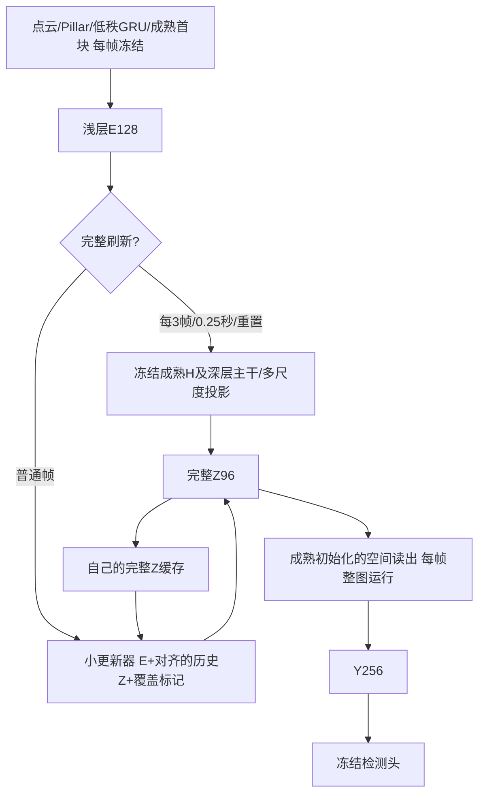

# 当前阶段：缓存读出之前的Z，联合训练修正与读出

2026-10-28用户确认：不直接预测检测头前Y，改为预测更早的特征，让后续可训练网络吸收历史对齐与更新误差。保留[H/D/Y已验证基线](int_hdy_reference_20261027.md)和[Y-only实验](int_y_only_plan_20261027.md)，本版仍以近似原INT精度、历史整体对齐与变化区域更新为目标，不以简化层数本身判定成功。

<!-- Z_CACHE_CURRENT_BEGIN -->
## 当前状态（2026-10-28 13:05）

| 完整验证轮次 | joint：更新器+可训练读出 | frozen：只训练更新器 | joint完整当前Z+适配读出 |
|---|---:|---:|---:|
| e0 | 30.27791030% | 30.27791030% | 75.67910703% |
| e4 | 61.85184773% | 61.55029591% | 75.13072860% |
| e8 | 70.31579063% | 71.08421804% | 75.12042534% |
| e12 | 72.37646420% | 72.67328808% | 75.27332101% |
| e16 | 73.39668927% | 73.58471563% | 75.23453138% |
| e20 | 73.89240280% | 73.96304334% | 75.14465799% |
| e21 | 73.93465822% | 73.96747972% | 75.10319799% |
| e22 | 74.04257194% | 74.36034701% | 75.05371359% |
| e23 | 74.09641398% | 74.32915325% | 75.03956587% |
| e24 | 74.10250862% | 74.33372234% | 74.99799351% |

两组24轮预算均完成且未满足平台规则，报告为budget_not_convergence。同轮e24 joint为74.10251%、frozen为74.33372%，前者低0.23121个百分点；冻结组best在e22，为74.36035%。当前结果仍不支持可训练读出提高最终精度。joint完整当前Z+适配读出降至74.9980%，比固定完整参照75.6791%低0.68111个百分点，存在完整路径退化，需用同一Z交换读出的诊断区分其来源。

两条已在原GPU5/7从各自e24 latest完整恢复到resume2，观察预算延至最多32轮：joint PID25159、frozen PID25234，均已通过工程检查并进入e25训练（2000/2200扫描）。保留优化器、调度器、读出、更新器和历史；冻结组从最新e24恢复，不将e22 best与e24优化器混用。joint e24 lr1e-4/1e-5、stale1；frozen lr2.5e-5、stale2，继续既定平台判据，不自动承诺满32轮。

同时新增e24固定512训练扫描配对诊断，GPU1 joint/PID26522、GPU3 frozen/PID26597，检查真实Z与教师历史干预的差别，并在同一个Z上比较固定/适配读出。方案见本文末尾，数据不用于调验证阈值，教师不写入真实缓存，不报告可部署AP或算量。Z专项6项测试通过（0.686秒）；两条诊断已完成512扫描，启动器均通过256项INT测试及真实轨迹一致性断言，结论见文末。最初按模块路径运行unittest触发仓库同名test.py的外部路径错误，改用既有discover方式后专项通过，此错误未影响训练。

本轮SSH最初超时，按用户授权恢复VPN后连接正常；没有修改或终止其他账号进程。最新关键备份为20261028_1300，两组e24完整恢复状态、各自best及同轮e24权重均保留，15,411,469字节，来源/中转/146目的地SHA256均为0f8c02dabd2c9be9c5674dbfa1472756839094efa2680c2536fbeb4c85bb42b4，校验通过。

实际5794扫描序列，两组均完整刷新Z 2005次、读出执行5794次，平均卷积计算114.97197812 GFLOPs（MAC×2），FM+Z持久张量35,884,800字节。计算高于Y-only的100.25688/103.97152G和HDY局部方案94.59200G，内存低于Y-only的52,012,800字节。当前Z尚未局部跳算，也未达到替代HDY的精度；共享GPU下不比较跨组延迟。

Y-only两组36轮预算结束，最佳70.58949%/70.76632%，未声称收敛，恢复点已保留。Z较Y-only的改善包含缓存位置、通道与参数差异，不能单独归因于读出适配。当前工作优先获取诊断证据并维持配对训练，之后再决定有针对性的修正与局部化。

- [joint截至24轮曲线](int_spike_results/cache_repair_20261017/z_only_w64_joint_p3_resume1_v1_20261028_history.json)
- [frozen截至24轮曲线](int_spike_results/cache_repair_20261017/z_only_w64_frozen_p3_resume1_v1_20261028_history.json)
- [联合组续训恢复](int_spike_results/cache_repair_20261017/z_only_w64_joint_p3_resume2_v1_20261028_resume.json)
- [冻结组续训恢复](int_spike_results/cache_repair_20261017/z_only_w64_frozen_p3_resume2_v1_20261028_resume.json)
- [最新备份清单](int_spike_results/cache_repair_20261017/z_cache_e24_backup_20261028_1300.json)
<!-- Z_CACHE_CURRENT_END -->

## 首版网络

Z定义为现有SplitCompactReadout的current(H浅层解码)+history(深层解码)之和，位于第一层空间卷积之前，96通道，带正负值。每次完整刷新产生的H/D只作临时中间值，唯一空间缓存是Z，前端GRU的FM状态保留。普通帧不调用H四层U、深层两级、任何deblock及current/history投影；空间读出和检测头每帧完整执行。

小更新器固定width64：输入E128/历史Z96/覆盖1，1×1→两层3×3→有符号1×1候选，另一个1×1产生g=.95sigmoid×valid，输出g×旧Z+(1-g)×候选。隐藏层ReLU，最终候选不加ReLU；Z在激活之前，非负约束会改变特征含义。候选N(0,.001)/bias0，门weight0/bias4。沿用Y-only近似复制初始方案，不同时加宽网络、改周期或换选区，避免把多种新改动混成一个结论。

第一阶段小更新器整图运行，尚不执行局部跳算；其空间依赖半径2便于后续局部化。先恢复精度，再把未选Z直接沿用对齐缓存、选中Z和必要邻域重新计算；读出仍整图处理新旧接缝。读出每帧运行会增加普通帧成本，实际分支及序列MAC、状态字节、有效延迟必须重新测量，不能套用Y-only数字。

## 两条固定实验

| 方案 | Z更新器 | 读出空间卷积/BN affine | BN运行统计 | 检测头/前端/完整Z生成器 |
|---|---|---|---|---|
| frozen | 训练，lr1e-4 | 冻结 | 冻结 | 冻结 |
| joint，主方案 | 训练，lr1e-4 | 成熟初始化后训练，lr1e-5 | 冻结 | 冻结 |

二者初始化、推理架构、总参数、Z定义、width64、period3/.25秒、种子303与数据完全一致，训练参数量不同。联合组需要在完整刷新帧也训练读出以保持完整路径表现；冻结组完整刷新没有可训练路径。这是读出适配这一训练方案的对照，不包装为训练步数或训练参数完全匹配的单因素实验。

教师是另一个固定读出和固定完整Z生成器，绝不与可训练读出共享参数。训练普通帧的完整Z仅作监督，用后丢弃，不写入学生历史；完整刷新按声明策略写入固定完整Z。训练目标为普通帧GT（有标签时）+0.2前景检测蒸馏+0.5 Z特征蒸馏，联合组刷新帧GT+0.2检测蒸馏。保留Z监督以约束缓存语义，避免读出适配使普通Z与完整刷新Z含义漂移。训练不额外加Y特征损失。

自己的连续Z递推、两步截断反传，AdamW wd1e-4、clip5；ReduceLROnPlateau因子.5/patience1/绝对AP阈值.0005/min1e-6。至少6轮、stale4且更新器lr≤2.5e-5才停止。首段最多16轮仅作观察预算，未收敛时基于结果决定后续。完整保存读出/更新器/优化器/scheduler/history/best及pending验证动作，禁止混用best权重和latest优化器。

## 验证和执行边界

- 32真实训练扫描核对普通帧H/D/投影调用为0，读出每帧调用一次，持久状态只有FM/Z96；完整刷新与原压缩成熟模型预测一致。
- 同一旧状态下，带教师监督和实际推理预测/Z写回逐位一致；梯度仅进入声明的模块，独立教师和检测头无梯度，BN运行统计不变。
- 单测验证有符号输出、半径2依赖、教师/读出参数隔离、读出训练不改变教师、冻结读出仍能向更新器传梯度，以及真实学生缓存不受监督写回影响。
- 每epoch完整5794扫描/1738标签，配对固定H控制75.53159775%、固定完整Z+固定读出75.67910703%、Z缓存学生；联合组额外评估完整当前Z+适配读出，以判断读出改进/退化与缓存误差的关系。各模式独立状态。
- 真实Conv/ConvTranspose hook分别计量普通/刷新路径，包含每帧读出；沿用Conv MAC×2口径，不含非卷积和Pillar点级Linear。状态内存与参数/峰值显存区分。允许GPU共享，污染时延置空，不终止其他进程。
- 本地main修改/push→181 pull；优先181，连接故障按已授权VPN策略处理，必要时146。旧Y-only两组保留当前32轮观察，勿因新方案启动删除其未收敛证据。

已进入训练阶段，当前证据见顶部状态表；尚无联合训练与冻结读出的同轮训练后比较，也没有精度达标或整体加速结论。若联合方案改善但完整当前Z+适配读出也同步改善，应区分普通检测适配与缓解缓存误差两种贡献；若仍差，继续用固定训练前缀诊断历史积累与当前修正，而不是只增加宽度。

## 实施与启动证据

实现0433fb2已本地main提交/push→181 pull。4项Z专项单测通过，两个启动器均通过254项INT测试。32真实扫描工程检查均PASSED：21普通帧H/D/多尺度投影调用0，读出每帧运行；FM/Z以外无持久空间状态；教师开关预测与Z逐位一致，声明范围外无梯度，BN运行统计不变。完整刷新与原压缩成熟模型最大预测差7.62939453125e-6。

实际分支卷积MAC：完整108109209600，普通30698035200，即216.2184192G/61.3960704G（MAC×2）。这是逐分支工程测量，不是全序列平均或已达标精度；增加每帧读出后普通帧比Y-only更贵，需要以精度、刷新摊销和状态内存综合判断。两组推理架构和总参数相同：更新器94,625参数、空间读出468,480参数；joint训练二者共563,105，frozen只训练94,625，其他模型参数都冻结。

- 主方案：181 GPU5/PID12297，z_only_w64_joint_p3_v1_20261028，首段16轮。
- 冻结对照：181 GPU7/PID12378，z_only_w64_frozen_p3_v1_20261028，首段16轮。
- 两条均已通过工程门槛并进入epoch0完整验证，尚无训练后AP。首轮应检查两条初始化Z缓存AP相同、固定控制复现，联合组full-adapted初始也与fixed控制一致。
- Y-only原两条继续原32轮观察；新阶段主目标为本文件，不再把Y-only旧状态表当成唯一排程。
- 初始化阶段心跳由60分钟缩短至30分钟，提示词仍“推进时序感知，仅完成异常通知”；稳定训练后按预计事件时间放宽。

原始证据：[联合组契约](int_spike_results/cache_repair_20261017/z_only_w64_joint_p3_v1_20261028_z_only_contract.json)、[联合组工程检查](int_spike_results/cache_repair_20261017/z_only_w64_joint_p3_v1_20261028_z_only_engineering.json)、[冻结组契约](int_spike_results/cache_repair_20261017/z_only_w64_frozen_p3_v1_20261028_z_only_contract.json)、[冻结组工程检查](int_spike_results/cache_repair_20261017/z_only_w64_frozen_p3_v1_20261028_z_only_engineering.json)。
## 2026-10-28 13:00：24轮节点与下一步诊断

两条24轮预算均结束，均为budget_not_convergence。joint e24为74.10250862%，frozen best e22为74.36034701%、e24为74.33372234%；同轮差0.23121个百分点。joint完整当前Z+适配读出降至74.99799351%，比固定完整参照75.67910703%低0.68111个百分点，提示读出适配的完整路径退化值得诊断；此现象本身不能证明缓存修正无效。frozen刚降lr至2.5e-5、stale2；joint仍1e-4/1e-5、stale1，均未满足停止判据。已在原GPU5/7分别从各自e24 latest精确续训至最多32轮，不重置调度器或混用best与latest。

利用空闲GPU1/3并行做固定512训练扫描的e24配对诊断，使用两组同轮checkpoint（冻结组也用e24，不选e22 best）。诊断不训练、不挑验证阈值、不向真实缓存写入教师状态：

1. 同一当前E比较真实递推Z、用前一帧完整教师Z替代历史、仅对齐自己的Z、仅对齐教师Z、有符号候选；按历史年龄1/2和全图/前景/覆盖外报告累计平方误差与目标能量。
2. 在完全相同的真实Z上分别执行固定读出与适配读出；在当前完整Z上执行适配读出。以独立固定完整Z读出作为Y目标，区分历史积累、当前更新不足与读出漂移。
3. 每扫描断言教师开关不改变实际预测/写回Z，历史不被反事实计算改写；年龄1时真实历史与教师历史干预应完全相同。冻结组两种读出应逐位一致。候选保持符号，不复用Y诊断中的ReLU。

这些是训练前缀的特征误差证据，不等于验证AP、可部署教师策略或计算收益。待结果完成后选择针对性的结构/训练改动，当前两条训练仍保持原对照。实现先本地main提交/push、181 pull后运行测试和实际诊断。

### e24诊断完成：优先检查当前帧重建与读出漂移

两条诊断均完成同一512训练扫描，179刷新帧、172个年龄1帧、161个年龄2帧；教师开关下真实预测/写回Z逐位一致，教师历史从未写入学生缓存，年龄1的历史干预等于真实递推。所有比较的目标能量、元素数及教师纯对齐误差在两组间完全一致，配对核验通过。两启动器全INT测试通过，合计每组256项；新增两项单测覆盖有符号候选、不改历史、在同一Z上交换读出且不改教师。

前景相对RMSE（越低越好，训练前缀特征误差，不是AP）：

| 组别/历史年龄 | 实际Z | 换成前一帧完整教师Z | 只对齐自己的Z | 固定读出处理实际Z后的Y | 适配读出处理同一Z后的Y |
|---|---:|---:|---:|---:|---:|
| joint / 1 | 0.52568 | 0.52568 | 0.75321 | 0.30107 | 0.31293 |
| joint / 2 | 0.54996 | 0.52448 | 0.72568 | 0.35830 | 0.35229 |
| frozen / 1 | 0.51835 | 0.51835 | 0.75321 | 0.28232 | 0.28232 |
| frozen / 2 | 0.54116 | 0.51695 | 0.72291 | 0.33363 | 0.33363 |

年龄2把旧Z换成完整教师历史，只减少约4.5%至4.6%的Z误差，明显没有消除主体误差；年龄1本来就从完整刷新出发，仍有约0.52误差。当前更新已比单纯对齐降低约24%至31%的误差，但单步重建仍值得优先检查。不能由此直接证明更新器容量不足，候选离线干预也不能作为可部署性能上限。

joint在同一个实际Z上使用适配读出：年龄1的Y误差反而增大约3.94%，年龄2改善约1.68%；把完整当前Z送入适配读出，也产生约0.187的前景相对RMSE，而冻结读出此项为0。结合完整验证路径下降0.681个百分点，目前不支持继续单纯加大读出适配强度。下一版优先保留成熟固定读出，针对单步Z重建检查浅层证据的空间上下文与修正结构；待本轮近平台曲线完成后，用有限且有明确对照的改动验证，避免重复扩大所有模块或拉长刷新周期。局部跳算仍以精度接近保留基线为前提。

原始证据：[联合组诊断](int_spike_results/cache_repair_20261017/z_only_joint_e24_diagnostic_v1_20261028_report.json)、[冻结组诊断](int_spike_results/cache_repair_20261017/z_only_frozen_e24_diagnostic_v1_20261028_report.json)、[配对核验](int_spike_results/cache_repair_20261017/z_only_e24_diagnostic_comparison_20261028.json)。
