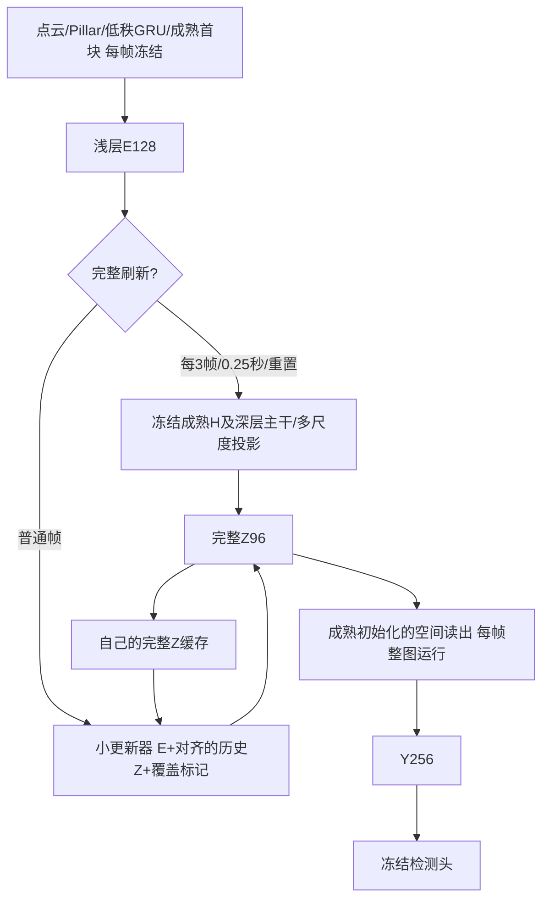

# 当前阶段：缓存读出之前的Z，联合训练修正与读出

2026-10-28用户确认：不直接预测检测头前Y，改为预测更早的特征，让后续可训练网络吸收历史对齐与更新误差。保留[H/D/Y已验证基线](int_hdy_reference_20261027.md)和[Y-only实验](int_y_only_plan_20261027.md)，本版仍以近似原INT精度、历史整体对齐与变化区域更新为目标，不以简化层数本身判定成功。

## 首版网络

Z定义为现有SplitCompactReadout的current(H浅层解码)+history(深层解码)之和，位于第一层空间卷积之前，96通道，带正负值。每次完整刷新产生的H/D只作临时中间值，唯一空间缓存是Z，前端GRU的FM状态保留。普通帧不调用H四层U、深层两级、任何deblock及current/history投影；空间读出和检测头每帧完整执行。

小更新器固定width64：输入E128/历史Z96/覆盖1，1×1→两层3×3→有符号1×1候选，另一个1×1产生g=.95sigmoid×valid，输出g×旧Z+(1-g)×候选。隐藏层ReLU，最终候选不加ReLU；Z在激活之前，非负约束会改变特征含义。候选N(0,.001)/bias0，门weight0/bias4。沿用Y-only近似复制初始方案，不同时加宽网络、改周期或换选区，避免把多种新改动混成一个结论。

第一阶段小更新器整图运行，尚不执行局部跳算；其空间依赖半径2便于后续局部化。先恢复精度，再把未选Z直接沿用对齐缓存、选中Z和必要邻域重新计算；读出仍整图处理新旧接缝。读出每帧运行会增加普通帧成本，实际分支及序列MAC、状态字节、有效延迟必须重新测量，不能套用Y-only数字。

## 两条固定实验

| 方案 | Z更新器 | 读出空间卷积/BN affine | BN运行统计 | 检测头/前端/完整Z生成器 |
|---|---|---|---|---|
| frozen | 训练，lr1e-4 | 冻结 | 冻结 | 冻结 |
| joint，主方案 | 训练，lr1e-4 | 成熟初始化后训练，lr1e-5 | 冻结 | 冻结 |

二者初始化、推理架构、总参数、Z定义、width64、period3/.25秒、种子303与数据完全一致，训练参数量不同。联合组需要在完整刷新帧也训练读出以保持完整路径表现；冻结组完整刷新没有可训练路径。这是读出适配这一训练方案的对照，不包装为训练步数或训练参数完全匹配的单因素实验。

教师是另一个固定读出和固定完整Z生成器，绝不与可训练读出共享参数。训练普通帧的完整Z仅作监督，用后丢弃，不写入学生历史；完整刷新按声明策略写入固定完整Z。训练目标为普通帧GT（有标签时）+0.2前景检测蒸馏+0.5 Z特征蒸馏，联合组刷新帧GT+0.2检测蒸馏。保留Z监督以约束缓存语义，避免读出适配使普通Z与完整刷新Z含义漂移。训练不额外加Y特征损失。

自己的连续Z递推、两步截断反传，AdamW wd1e-4、clip5；ReduceLROnPlateau因子.5/patience1/绝对AP阈值.0005/min1e-6。至少6轮、stale4且更新器lr≤2.5e-5才停止。首段最多16轮仅作观察预算，未收敛时基于结果决定后续。完整保存读出/更新器/优化器/scheduler/history/best及pending验证动作，禁止混用best权重和latest优化器。

## 验证和执行边界

- 32真实训练扫描核对普通帧H/D/投影调用为0，读出每帧调用一次，持久状态只有FM/Z96；完整刷新与原压缩成熟模型预测一致。
- 同一旧状态下，带教师监督和实际推理预测/Z写回逐位一致；梯度仅进入声明的模块，独立教师和检测头无梯度，BN运行统计不变。
- 单测验证有符号输出、半径2依赖、教师/读出参数隔离、读出训练不改变教师、冻结读出仍能向更新器传梯度，以及真实学生缓存不受监督写回影响。
- 每epoch完整5794扫描/1738标签，配对固定H控制75.53159775%、固定完整Z+固定读出75.67910703%、Z缓存学生；联合组额外评估完整当前Z+适配读出，以判断读出改进/退化与缓存误差的关系。各模式独立状态。
- 真实Conv/ConvTranspose hook分别计量普通/刷新路径，包含每帧读出；沿用Conv MAC×2口径，不含非卷积和Pillar点级Linear。状态内存与参数/峰值显存区分。允许GPU共享，污染时延置空，不终止其他进程。
- 本地main修改/push→181 pull；优先181，连接故障按已授权VPN策略处理，必要时146。旧Y-only两组保留当前32轮观察，勿因新方案启动删除其未收敛证据。

目前是实现与启动阶段，没有Z缓存训练AP、延迟或省算量结论。若联合方案改善但完整当前Z+适配读出也同步改善，应区分普通检测适配与缓解缓存误差两种贡献；若仍差，继续用固定训练前缀诊断历史积累与当前修正，而不是只增加宽度。
