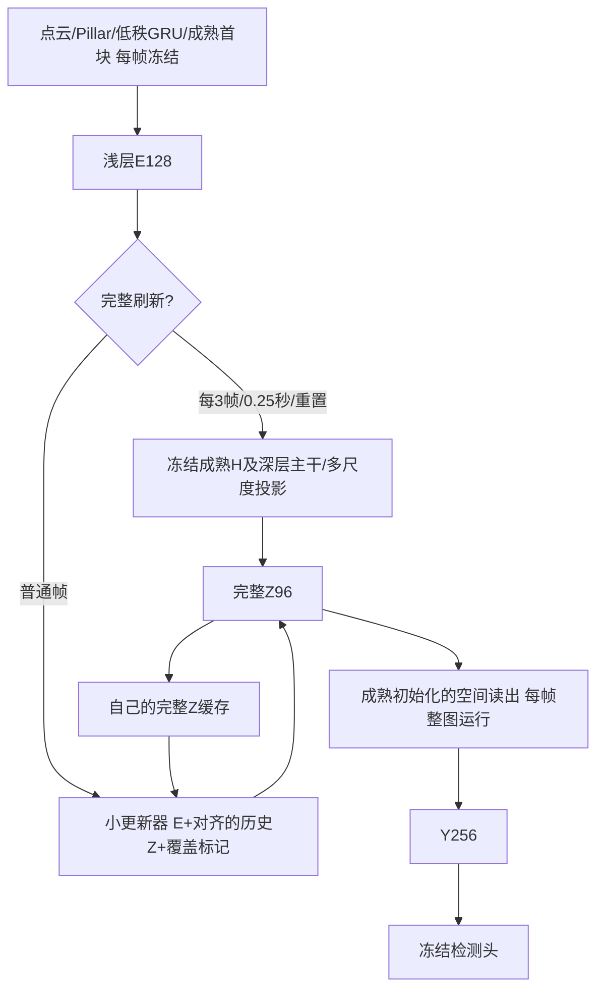

# 当前阶段：缓存读出之前的Z，联合训练修正与读出

2026-10-28用户确认：不直接预测检测头前Y，改为预测更早的特征，让后续可训练网络吸收历史对齐与更新误差。保留[H/D/Y已验证基线](int_hdy_reference_20261027.md)和[Y-only实验](int_y_only_plan_20261027.md)，本版仍以近似原INT精度、历史整体对齐与变化区域更新为目标，不以简化层数本身判定成功。

<!-- Z_CACHE_CURRENT_BEGIN -->
## 当前状态（2026-10-28 08:00）

| 完整验证轮次 | joint：更新器+可训练读出 | frozen：只训练更新器 | joint完整当前Z+适配读出 |
|---|---:|---:|---:|
| e0 | 30.27791030% | 30.27791030% | 75.67910703% |
| e1 | 44.55867935% | 45.88392678% | 74.64382091% |
| e2 | 51.66651200% | 53.16299374% | 74.84484639% |
| e3 | 57.28794647% | 57.60840255% | 75.06716493% |
| e4 | 61.85184773% | 61.55029591% | 75.13072860% |
| e5 | 65.20143058% | 65.97972893% | 75.17274959% |
| e6 | 67.79228552% | 68.77099898% | 75.17114314% |
| e7 | 69.29161246% | 70.19872396% | 75.13472311% |
| e8 | 70.31579063% | 71.08421804% | 75.12042534% |
| e9 | 70.98287933% | 71.64017907% | 75.17346796% |
| e10 | 71.51643721% | 71.92604237% | 75.19784306% |
| e11 | 72.08178712% | 72.35250480% | 75.17010764% |
| e12 | 72.37646420% | 72.67328808% | 75.27332101% |
| e13 | 待完成 | 72.95699320% | 待完成 |
| e14 | 待完成 | 73.25418693% | 待完成 |
| e15 | 待完成 | 73.47127453% | 待完成 |
| e16 | 待完成 | 73.58471563% | 待完成 |

两组初始化严格一致，固定H控制为75.53159775%，固定完整Z+固定读出为75.67910703%，每轮复现。同轮e12 joint为72.37646420%、frozen为72.67328808%，joint低0.29682个百分点；完整当前Z+适配读出为75.27332101%，低于固定读出0.40579个百分点。联合组差距有所缩小，尚不能证明训练读出优于冻结。

冻结组完成16轮预算，best为e16的73.58471563%，比完整参照低2.09439个百分点；e14/e15/e16持续改善，lr1e-4、stale0，报告明确为budget_not_convergence。按上一轮预定判据，已在原GPU7启动z_only_w64_frozen_p3_resume1_v1_20261028（PID27353），从e16 latest恢复更新器、读出、优化器、调度器与历史，最多续至24轮，保持所有结构/损失/周期/验证配置不变。启动前核对epoch16/next_action=train/stale0；启动器工程检查已通过，resume.json确认next_epoch=17，实际进入e17训练600扫描、损失有限；恢复点SHA为646b44b9786f594b5e306a0ef24d6cbd70348b8453f8aa31ace65e08683cc4d2。

joint原运行仍在e13验证，保持到16轮后按相同判据决定有限续训，禁止跨轮次直接排名。冻结组16轮结束只是观察节点，不构成路线完成，当前也不进入局部跳算。最近恢复点及best已备份到146：joint e12和frozen e16，13,310,220字节，SHA f7b0619ba4307268e9151ff106e1b46916a230f0233305a554a253047581c47d，来源/中转/目的地一致。当前继续60分钟检查。

实际5794扫描序列，两组均完整刷新Z 2005次，读出执行5794次；平均卷积计算114.97197812 GFLOPs（MAC×2），FM+Z持久张量35,884,800字节。该成本包含每帧读出，高于Y-only的100.25688/103.97152G和保留HDY局部方案94.59200G；内存低于Y-only的52,012,800字节。目前尚未局部跳算，也未取得接近基线的精度。joint共享GPU无有效延迟，不做跨组速度比较。

Y-only两条36轮观察预算已经结束，最佳70.58949%/70.76632%，未达到平台判据；暂保留为有完整恢复点的预算结束对照，不继续机械追加同结构训练。主线仍为Z：其冻结组e7已接近Y-only 36轮水平，但两者缓存位置、通道数、参数量与计算量不同，不能将训练更快全部归因于读出或宣布精度已达标。Z两条正常继续。早期工程检查和Y对照预算节点已结束，当前只等待稳定训练，将心跳从30分钟放宽至60分钟，提示词保持“推进时序感知，仅完成异常通知”；接近结束或出现可行动事件时再调整。

- [joint完整曲线](int_spike_results/cache_repair_20261017/z_only_w64_joint_p3_v1_20261028_history.json)
- [frozen完整曲线](int_spike_results/cache_repair_20261017/z_only_w64_frozen_p3_v1_20261028_history.json)
- [最新Z恢复点备份清单](int_spike_results/cache_repair_20261017/z_cache_backup_20261028_0800.json)
- [冻结组恢复核验](int_spike_results/cache_repair_20261017/z_only_w64_frozen_p3_resume1_v1_20261028_resume.json)
- [冻结组续训启动](int_spike_results/cache_repair_20261017/z_only_w64_frozen_p3_resume1_v1_20261028_launch.json)
<!-- Z_CACHE_CURRENT_END -->

## 首版网络

Z定义为现有SplitCompactReadout的current(H浅层解码)+history(深层解码)之和，位于第一层空间卷积之前，96通道，带正负值。每次完整刷新产生的H/D只作临时中间值，唯一空间缓存是Z，前端GRU的FM状态保留。普通帧不调用H四层U、深层两级、任何deblock及current/history投影；空间读出和检测头每帧完整执行。

小更新器固定width64：输入E128/历史Z96/覆盖1，1×1→两层3×3→有符号1×1候选，另一个1×1产生g=.95sigmoid×valid，输出g×旧Z+(1-g)×候选。隐藏层ReLU，最终候选不加ReLU；Z在激活之前，非负约束会改变特征含义。候选N(0,.001)/bias0，门weight0/bias4。沿用Y-only近似复制初始方案，不同时加宽网络、改周期或换选区，避免把多种新改动混成一个结论。

第一阶段小更新器整图运行，尚不执行局部跳算；其空间依赖半径2便于后续局部化。先恢复精度，再把未选Z直接沿用对齐缓存、选中Z和必要邻域重新计算；读出仍整图处理新旧接缝。读出每帧运行会增加普通帧成本，实际分支及序列MAC、状态字节、有效延迟必须重新测量，不能套用Y-only数字。

## 两条固定实验

| 方案 | Z更新器 | 读出空间卷积/BN affine | BN运行统计 | 检测头/前端/完整Z生成器 |
|---|---|---|---|---|
| frozen | 训练，lr1e-4 | 冻结 | 冻结 | 冻结 |
| joint，主方案 | 训练，lr1e-4 | 成熟初始化后训练，lr1e-5 | 冻结 | 冻结 |

二者初始化、推理架构、总参数、Z定义、width64、period3/.25秒、种子303与数据完全一致，训练参数量不同。联合组需要在完整刷新帧也训练读出以保持完整路径表现；冻结组完整刷新没有可训练路径。这是读出适配这一训练方案的对照，不包装为训练步数或训练参数完全匹配的单因素实验。

教师是另一个固定读出和固定完整Z生成器，绝不与可训练读出共享参数。训练普通帧的完整Z仅作监督，用后丢弃，不写入学生历史；完整刷新按声明策略写入固定完整Z。训练目标为普通帧GT（有标签时）+0.2前景检测蒸馏+0.5 Z特征蒸馏，联合组刷新帧GT+0.2检测蒸馏。保留Z监督以约束缓存语义，避免读出适配使普通Z与完整刷新Z含义漂移。训练不额外加Y特征损失。

自己的连续Z递推、两步截断反传，AdamW wd1e-4、clip5；ReduceLROnPlateau因子.5/patience1/绝对AP阈值.0005/min1e-6。至少6轮、stale4且更新器lr≤2.5e-5才停止。首段最多16轮仅作观察预算，未收敛时基于结果决定后续。完整保存读出/更新器/优化器/scheduler/history/best及pending验证动作，禁止混用best权重和latest优化器。

## 验证和执行边界

- 32真实训练扫描核对普通帧H/D/投影调用为0，读出每帧调用一次，持久状态只有FM/Z96；完整刷新与原压缩成熟模型预测一致。
- 同一旧状态下，带教师监督和实际推理预测/Z写回逐位一致；梯度仅进入声明的模块，独立教师和检测头无梯度，BN运行统计不变。
- 单测验证有符号输出、半径2依赖、教师/读出参数隔离、读出训练不改变教师、冻结读出仍能向更新器传梯度，以及真实学生缓存不受监督写回影响。
- 每epoch完整5794扫描/1738标签，配对固定H控制75.53159775%、固定完整Z+固定读出75.67910703%、Z缓存学生；联合组额外评估完整当前Z+适配读出，以判断读出改进/退化与缓存误差的关系。各模式独立状态。
- 真实Conv/ConvTranspose hook分别计量普通/刷新路径，包含每帧读出；沿用Conv MAC×2口径，不含非卷积和Pillar点级Linear。状态内存与参数/峰值显存区分。允许GPU共享，污染时延置空，不终止其他进程。
- 本地main修改/push→181 pull；优先181，连接故障按已授权VPN策略处理，必要时146。旧Y-only两组保留当前32轮观察，勿因新方案启动删除其未收敛证据。

已进入训练阶段，当前证据见顶部状态表；尚无联合训练与冻结读出的同轮训练后比较，也没有精度达标或整体加速结论。若联合方案改善但完整当前Z+适配读出也同步改善，应区分普通检测适配与缓解缓存误差两种贡献；若仍差，继续用固定训练前缀诊断历史积累与当前修正，而不是只增加宽度。

## 实施与启动证据

实现0433fb2已本地main提交/push→181 pull。4项Z专项单测通过，两个启动器均通过254项INT测试。32真实扫描工程检查均PASSED：21普通帧H/D/多尺度投影调用0，读出每帧运行；FM/Z以外无持久空间状态；教师开关预测与Z逐位一致，声明范围外无梯度，BN运行统计不变。完整刷新与原压缩成熟模型最大预测差7.62939453125e-6。

实际分支卷积MAC：完整108109209600，普通30698035200，即216.2184192G/61.3960704G（MAC×2）。这是逐分支工程测量，不是全序列平均或已达标精度；增加每帧读出后普通帧比Y-only更贵，需要以精度、刷新摊销和状态内存综合判断。两组推理架构和总参数相同：更新器94,625参数、空间读出468,480参数；joint训练二者共563,105，frozen只训练94,625，其他模型参数都冻结。

- 主方案：181 GPU5/PID12297，z_only_w64_joint_p3_v1_20261028，首段16轮。
- 冻结对照：181 GPU7/PID12378，z_only_w64_frozen_p3_v1_20261028，首段16轮。
- 两条均已通过工程门槛并进入epoch0完整验证，尚无训练后AP。首轮应检查两条初始化Z缓存AP相同、固定控制复现，联合组full-adapted初始也与fixed控制一致。
- Y-only原两条继续原32轮观察；新阶段主目标为本文件，不再把Y-only旧状态表当成唯一排程。
- 初始化阶段心跳由60分钟缩短至30分钟，提示词仍“推进时序感知，仅完成异常通知”；稳定训练后按预计事件时间放宽。

原始证据：[联合组契约](int_spike_results/cache_repair_20261017/z_only_w64_joint_p3_v1_20261028_z_only_contract.json)、[联合组工程检查](int_spike_results/cache_repair_20261017/z_only_w64_joint_p3_v1_20261028_z_only_engineering.json)、[冻结组契约](int_spike_results/cache_repair_20261017/z_only_w64_frozen_p3_v1_20261028_z_only_contract.json)、[冻结组工程检查](int_spike_results/cache_repair_20261017/z_only_w64_frozen_p3_v1_20261028_z_only_engineering.json)。